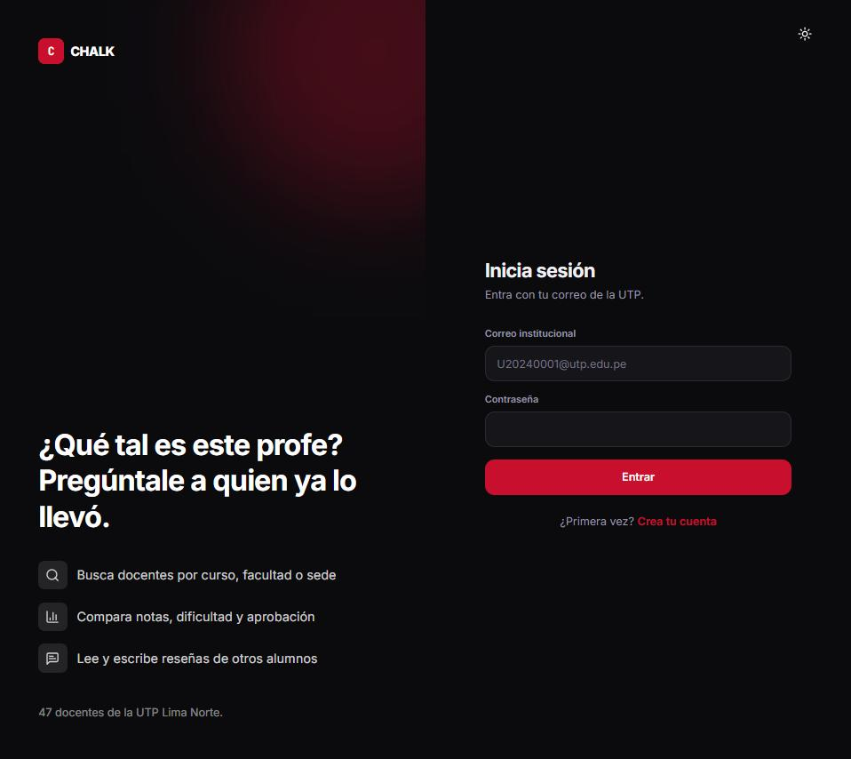
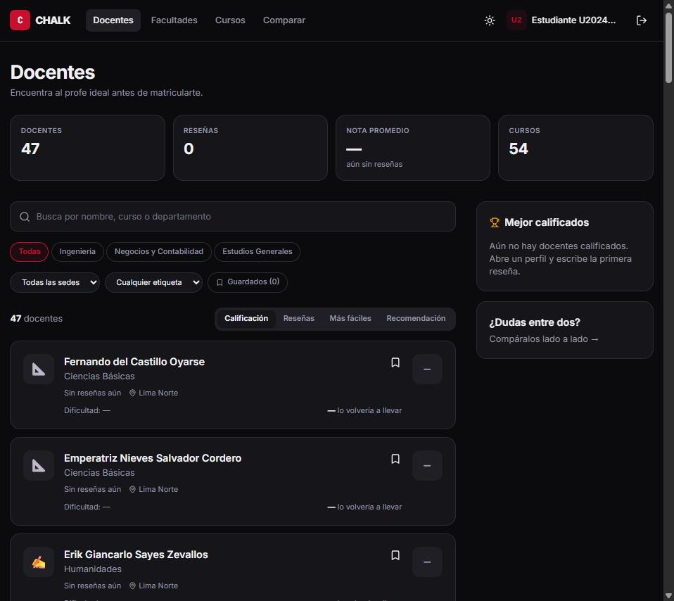
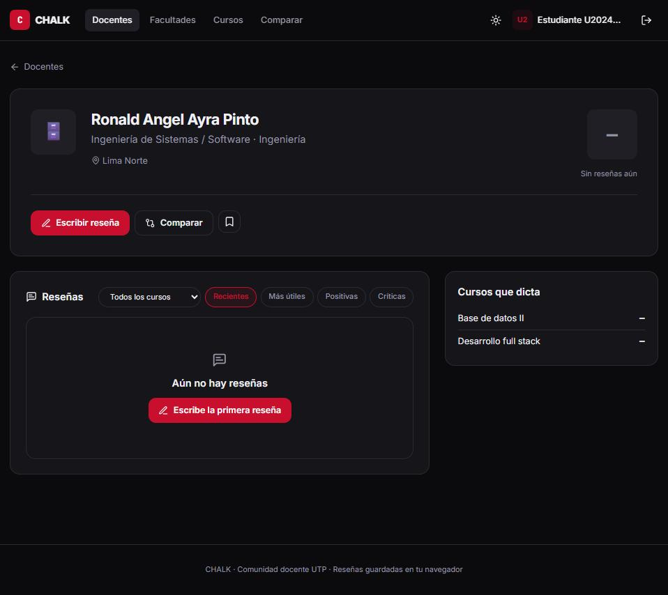
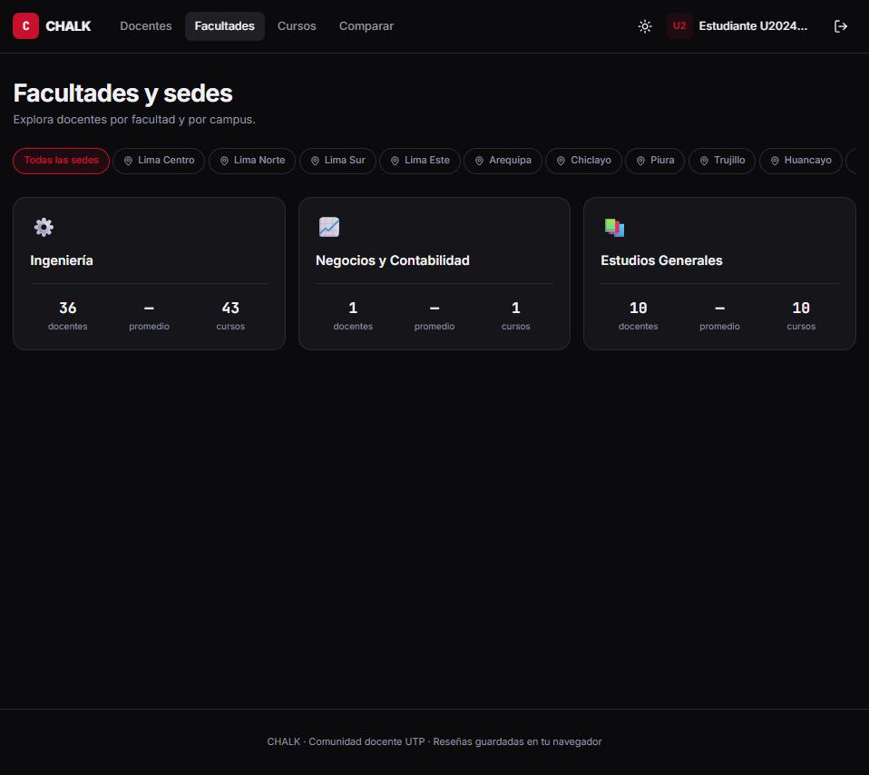
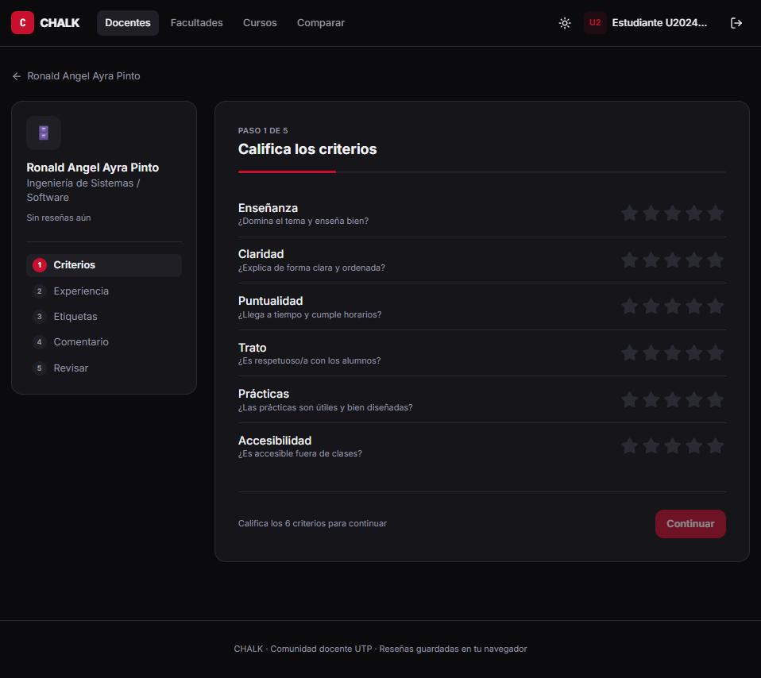

<p align="center">
  <a href="https://github.com/Nakusuo"></a>
</p>

# CHALK

CHALK es una comunidad docente para estudiantes de la UTP: un sitio donde puedes buscar profesores por facultad, sede o curso, ver cómo los califican otros alumnos y dejar tu propia reseña antes de matricularte. La idea nació de algo muy simple: todos preguntamos "¿qué tal es este profe?" antes de elegir horario, y quería tener esas respuestas en un solo lugar.

Lo hice como proyecto de la universidad mientras estudio Ingeniería de Software. La versión 2 está reescrita en React + TypeScript, con un diseño nuevo, modo claro/oscuro y sin backend.



## Cómo se ve

**Lista de docentes.** Estadísticas generales, ranking de los mejores calificados, buscador, filtros por facultad, sede y etiqueta, y orden por calificación, reseñas, dificultad o recomendación.



**Perfil de un docente.** Nota general, porcentaje que lo volvería a llevar, dificultad, criterios, distribución de notas y nota por curso, todo calculado a partir de las reseñas.



**Facultades y sedes.** Cada facultad con su número de docentes, promedio y cursos, más filtros por sede.



**Escribir una reseña.** Un formulario en 5 pasos: primero calificas los criterios con estrellas y luego vas completando el resto.



## Qué puedes hacer

- Iniciar sesión o registrarte con tu correo institucional (`U...@utp.edu.pe`); el código de estudiante se valida con expresiones regulares.
- Explorar 47 docentes reales de la UTP Lima Norte. No hay notas inventadas: todas las métricas salen de las reseñas que escriben los alumnos.
- Buscar y filtrar docentes por nombre, curso, facultad, sede o etiquetas (Exigente, Explica bien, Puntual...).
- Ver el perfil completo de cada docente con métricas, gráficos animados y las reseñas de otros alumnos, y marcar reseñas como útiles.
- Escribir una reseña paso a paso: criterios con estrellas, dificultad, carga de trabajo, si lo volverías a llevar, etiquetas y comentario, con vista previa antes de enviar.
- Explorar cursos, comparar dos docentes lado a lado y revisar tu perfil.
- Guardar docentes, borrar tus reseñas, editar tus datos y compartir búsquedas (los filtros viven en la URL).
- Cambiar entre tema claro y oscuro.

Todo se guarda en el `localStorage` del navegador (sesión, reseñas, votos de "útil", guardados y tema), así que no necesita servidor ni base de datos.

## Tecnologías

- Vite + React 18 + TypeScript
- Tailwind CSS con tokens de color propios y modo claro/oscuro
- React Router (HashRouter, funciona en cualquier hosting estático)
- `localStorage` como capa de persistencia

```
src/
  data/        datos de ejemplo (seed.ts), tipos y selectores (db.ts)
  lib/         store reactivo sobre localStorage
  components/  layout, tarjetas, reseñas y piezas de UI
  pages/       una página por ruta
```

## Cómo correrlo

```bash
git clone https://github.com/Nakusuo/CHALK.git
cd CHALK
npm install
npm run dev        # http://localhost:5173
npm run build      # genera dist/ listo para publicar
```

Entra con cualquier correo del tipo `U20240001@utp.edu.pe` y una contraseña cualquiera.

